<div align="center">

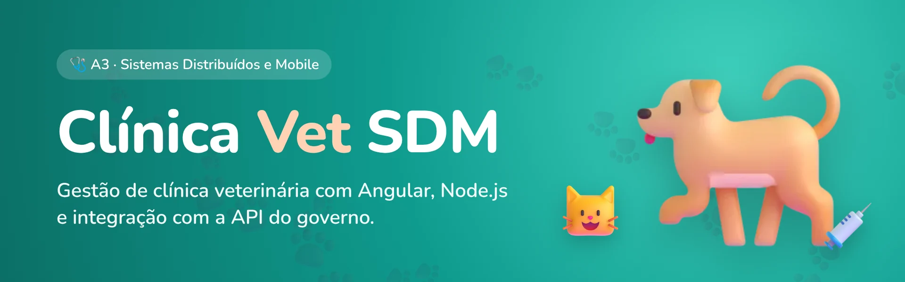

<h3>🐾 Sistema web para gestão de clínica veterinária com integração de APIs</h3>

<p>
  
  
  
  
  
  
</p>
<p>
  
  
  
  
</p>

<p>
  <a href="#-funcionalidades">Funcionalidades</a> •
  <a href="#-telas">Telas</a> •
  <a href="#%EF%B8%8F-arquitetura">Arquitetura</a> •
  <a href="#-como-rodar">Como rodar</a> •
  <a href="#-testes">Testes</a> •
  <a href="#-equipe">Equipe</a>
</p>

</div>

---

## 📖 Sobre

O **Clínica Vet SDM** organiza o dia a dia de uma clínica veterinária: tutores, animais, consultas, vacinas e microchip. Ele também **conversa com uma API do governo** (simulada), que recebe o cadastro dos animais microchipados e as vacinas antirrábicas.

Tudo roda na sua máquina (`localhost`). Só a consulta de CEP usa a internet (ViaCEP real).

> [!NOTE]
> Projeto da avaliação **A3 de Sistemas Distribuídos e Mobile**. Os dados de exemplo são fictícios.

## ✨ Funcionalidades

<table>
  <tr>
    <td width="50%" valign="top">

**🔐 Acesso seguro**
- Login de veterinários com senha criptografada (bcrypt)
- Bloqueio de conta inativa ou com senha não confirmada
- Confirmação de senha por código (e-mail simulado)
- Sessão com token de 8 horas

**👥 Tutores e 🐶 animais**
- Cadastro com validação de CPF e telefone
- Endereço preenchido pelo **CEP (ViaCEP)**
- Espécies e raças, ficha completa de cada animal
- Animais inativos ficam no histórico

  </td>
    <td width="50%" valign="top">

**🩺 Atendimento**
- Consultas com diagnóstico, tratamento, peso e temperatura
- Vacinas com lote, dose e próxima aplicação
- Painel de **próximas doses** e doses atrasadas

**🏛️ Integração com o governo**
- Microchip de 15 dígitos, sem repetição
- Cadastro, atualização e antirrábica **enviados na hora**
- Governo fora do ar? Fica **pendente** e é reenviado sozinho a cada 60 s
- Chave de idempotência: reenvio **nunca duplica** registro

  </td>
  </tr>
</table>

## 📸 Telas

<div align="center">

| 🏠 Painel | 🐕 Ficha do animal |
|:---:|:---:|
| 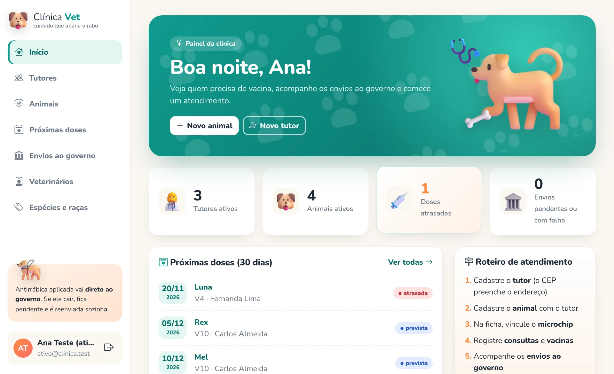 | 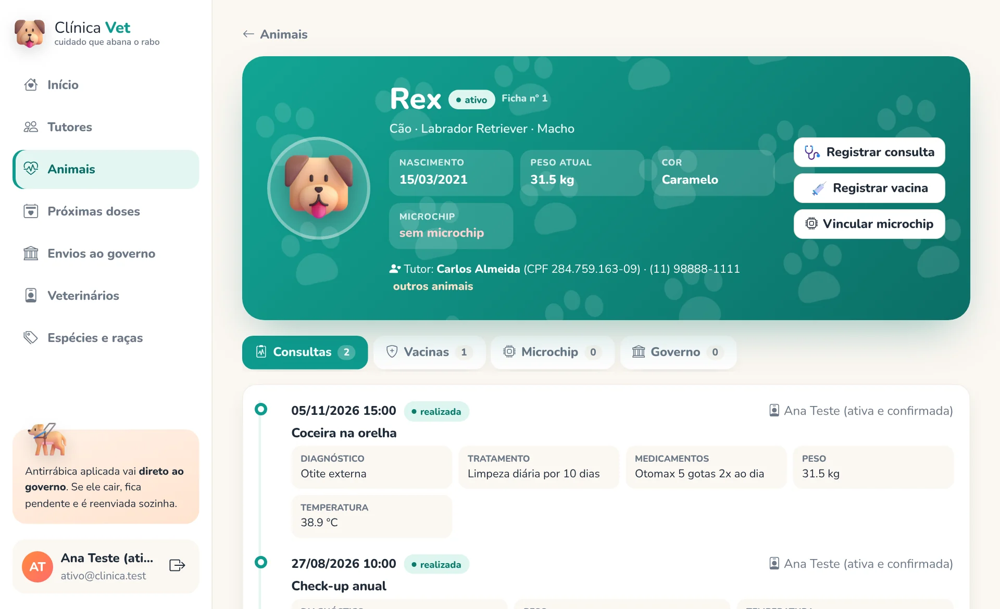 |
| **🔑 Login** | **🐾 Animais** |
| 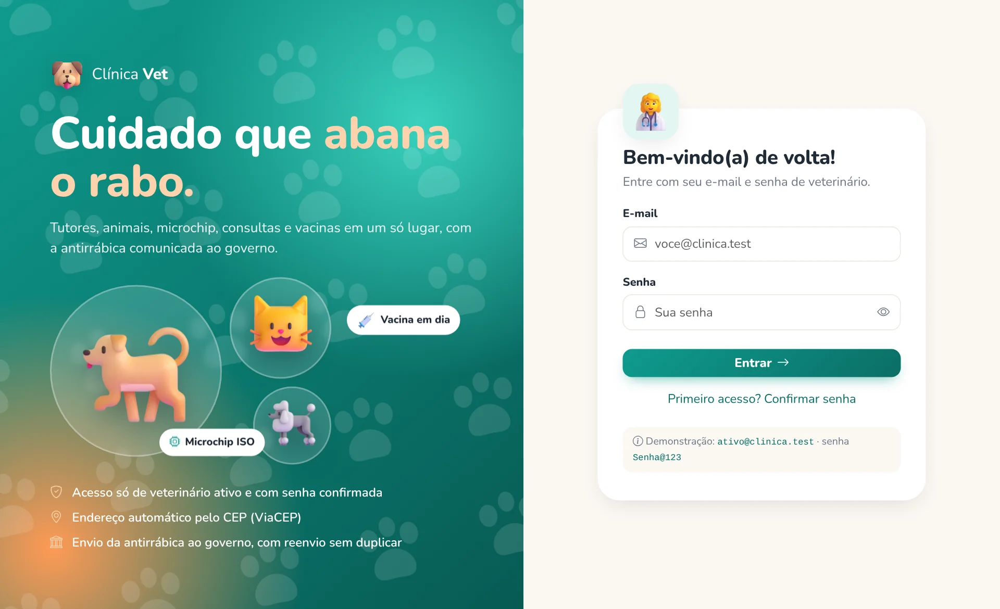 | 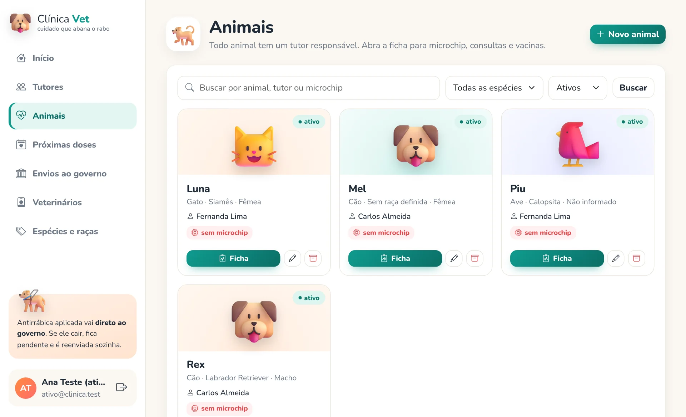 |
| **💉 Próximas doses** | **🏛️ Envios ao governo** |
| 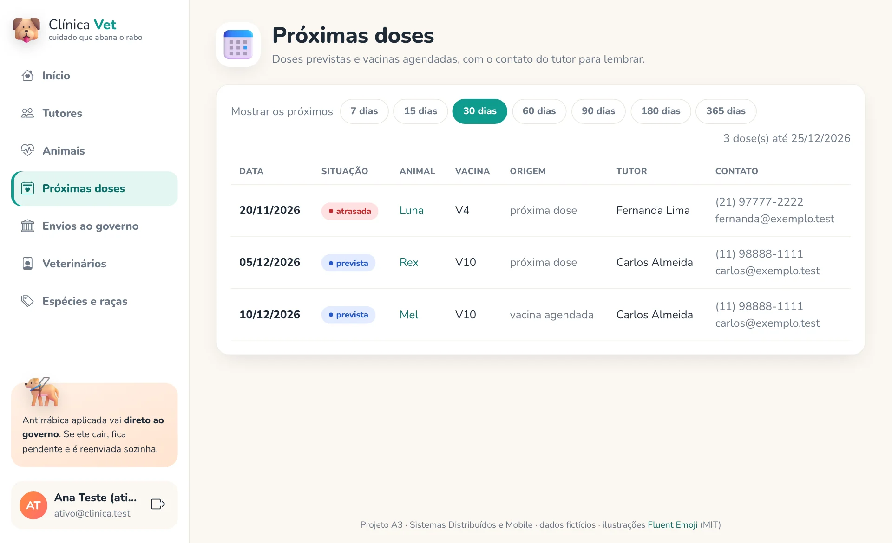 | 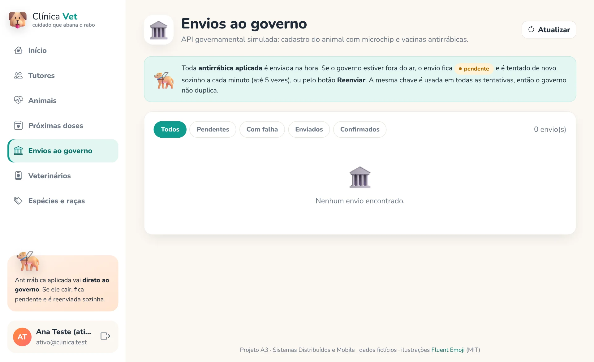 |

<b>📱 No celular</b><br>
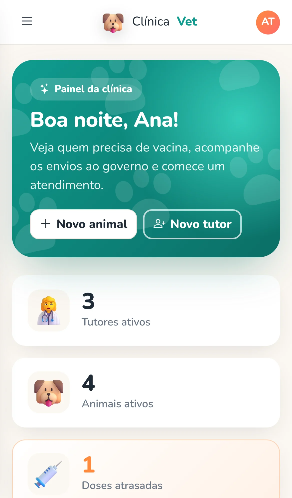
&nbsp;&nbsp;
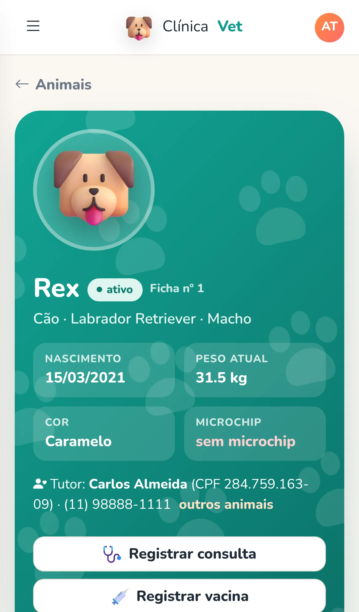

</div>

## 🏗️ Arquitetura

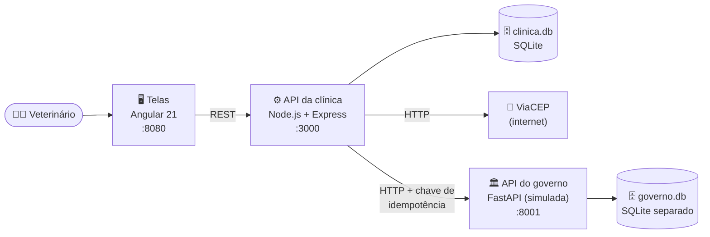

<details>
<summary><b>🔁 Como funciona o envio ao governo</b></summary>

<br>

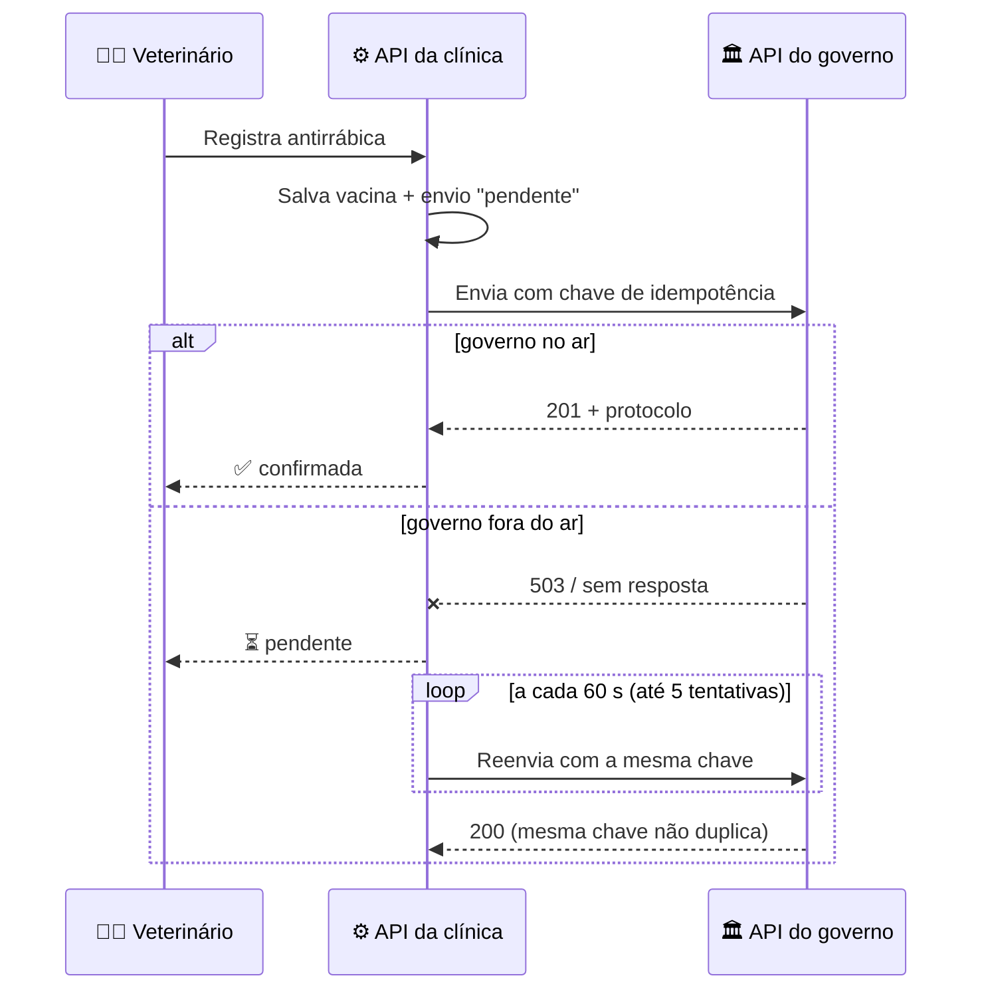

</details>

### 🧰 Tecnologias e por quê

| | Parte | Tecnologia | Por quê |
|:---:|---|---|---|
| 🖥️ | Telas | Angular 21 + Bootstrap 5.3 (`frontend-angular/`) | Uma tela = um componente (`.ts` + `.html`), rotas com proteção por login e tema próprio de clínica veterinária. Funciona no celular. O front antigo em HTML puro continua em `frontend/` (`npm run front:antigo`). |
| ⚙️ | API da clínica | Node.js 22+ com Express 5 | Mesma linguagem das telas, simples e muito usada. |
| 🗄️ | Banco da clínica | SQLite nativo do Node (`node:sqlite`) | Banco relacional sem instalar servidor nem compilar biblioteca. |
| 🔐 | Senha e sessão | bcryptjs + token de sessão (8 h) | A senha nunca é guardada pura. |
| 🐍 | API do governo | Python 3.10+ com FastAPI, SQLAlchemy e Uvicorn | Swagger automático em `/docs` e validação automática dos dados. |
| 🏛️ | Banco do governo | SQLite (`governo.db`) | Banco próprio, separado do da clínica (exigência do enunciado). |
| 📮 | CEP | ViaCEP (API pública real) | Exigência do enunciado. |
| 🧪 | Testes | Postman (`postman/`) e Swagger do governo | Coleções prontas para rodar no Runner. |

> [!NOTE]
> No plano inicial (`docs/DIVISAO_DO_TRABALHO.pdf`) a API da clínica seria em Python. O grupo fez em Node.js (porta 3000); vale o que está aqui.

## 🚀 Como rodar

### 1️⃣ Pré-requisitos (uma vez só)

| Ferramenta | Versão | Como conferir |
|---|---|---|
|  [nodejs.org](https://nodejs.org) | 22.13 ou mais nova | `node -v` |
|  [python.org](https://www.python.org) | 3.10 ou mais nova | `python --version` |
|  (opcional) | qualquer | para rodar as coleções |

> [!TIP]
> No Windows, marque **"Add python.exe to PATH"** ao instalar o Python.

### 2️⃣ Abra 3 terminais na pasta do projeto

Descompacte o zip (ou faça `git clone`) e abra **3 terminais** dentro da pasta do projeto. No VS Code: *Terminal › Novo terminal* três vezes.

### 3️⃣ Terminal 1 · ⚙️ API da clínica (porta 3000)

```bash
npm install
npm run banco:recriar:demo
npm start
```

✅ Pronto quando aparecer `API da Clínica rodando na porta 3000`.

> [!IMPORTANT]
> Deixe esse terminal aberto: o **código de confirmação de senha** (e-mail simulado) aparece nele.

### 4️⃣ Terminal 2 · 🏛️ API do governo (porta 8001)

<details open>
<summary><b>🪟 Windows</b></summary>

```bash
cd api_gov
python -m venv venv
venv\Scripts\python -m pip install -r requirements.txt
venv\Scripts\python -m uvicorn app.main:app --port 8001
```

</details>

<details>
<summary><b>🐧 Linux / 🍎 Mac</b></summary>

```bash
cd api_gov
python3 -m venv venv
venv/bin/python -m pip install -r requirements.txt
venv/bin/python -m uvicorn app.main:app --port 8001
```

</details>

✅ Pronto quando aparecer `Uvicorn running on http://127.0.0.1:8001`. Swagger: <http://localhost:8001/docs>

### 5️⃣ Terminal 3 · 🖥️ Telas (porta 8080)

```bash
npm run front:instalar   # só na primeira vez
npm run front
```

🎉 Abra **<http://localhost:8080>** e entre com `ativo@clinica.test` e a senha `Senha@123`.

### 🔄 Das próximas vezes

Não precisa instalar de novo: `npm start` (terminal 1), o comando do `uvicorn` dentro de `api_gov` (terminal 2) e `npm run front` (terminal 3).

Para voltar o banco da clínica aos dados de exemplo, pare a API (Ctrl+C) e rode `npm run banco:recriar:demo`.

> [!TIP]
> Quer mostrar online? Veja [`docs/DEPLOY_ONLINE.md`](docs/DEPLOY_ONLINE.md): telas no **Firebase** e as duas APIs no **Render**, no plano grátis.

### 📜 Scripts

| Comando | O que faz |
|---|---|
| `npm start` | Sobe a API da clínica na porta 3000 |
| `npm run front` | Sobe as telas em Angular na porta 8080 |
| `npm run front:instalar` | Instala as dependências do front |
| `npm run front:antigo` | Sobe o front antigo em HTML puro |
| `npm run banco:recriar:demo` | Apaga e recria o banco com os dados de exemplo |
| `npm run banco:recriar` | Apaga e recria o banco vazio |

## 👤 Contas e dados de teste

Senha das três contas: `Senha@123` (definida em `api_clinica/database/veterinariosTeste.js`).

| E-mail | Situação | Serve para |
|---|---|---|
| `ativo@clinica.test` | 🟢 ativo e senha confirmada | entrar (teste 1) |
| `inativo@clinica.test` | 🔴 inativo | teste 2 (bloqueado) |
| `pendente@clinica.test` | 🟡 senha não confirmada | teste 3 (bloqueado) |

O `banco:recriar:demo` também cria 3 tutores e 5 animais (🐶 Rex, 🐶 Mel, 🐱 Luna, 🐦 Piu e 🐶 Bidu, este inativo), além de consultas e vacinas.

## 🧪 Testes

Os **16 testes obrigatórios** do enunciado foram executados e documentados em [`docs/RELATORIO_DE_TESTES.md`](docs/RELATORIO_DE_TESTES.md).

| Coleção (pasta `postman/`) | Cobre |
|---|---|
| 📦 `Clinica_Vet_Bia` | Login, veterinários, consultas e vacinas (testes 1 a 4, 9 e 10) |
| 📦 `Clinica_Vet_Tutores_Animais_Microchip_Governo` | Tutores, CEP, espécies, raças, animais, microchip e envio ao governo (testes 5 a 8 e 12 a 16). Precisa das duas APIs rodando. |
| 📦 `Clinica_Vet-API Governo` | Rotas da API do governo direto. Use a variável `base_url = http://localhost:8001/api/governo`. |

**Como rodar:** no Postman, faça *Import* dos arquivos da pasta `postman/` e use *Run collection*, com as APIs rodando e o banco recém-recriado. A API do governo também pode ser testada pelo Swagger em <http://localhost:8001/docs>.

### 🖼️ Evidências (prints)

| Pasta | Responsável | Conteúdo |
|---|---|---|
| [`docs/prints/bia/`](docs/prints/bia) | Bia | Login, consultas e vacinas |
| [`docs/prints/joao/`](docs/prints/joao) | João | CEP pelo ViaCEP (teste 6) |
| [`docs/prints/cris/`](docs/prints/cris) | Cristiano | API do governo no Postman (23 cenários) |
| [`docs/prints/caio/`](docs/prints/caio) | Caio | Os 16 testes pelas telas em Angular, newman e celular |

## 🛠️ Problemas comuns

<details>
<summary><b>Clique para ver as soluções</b></summary>

<br>

| Aparece | O que fazer |
|---|---|
| `npm.ps1 não pode ser carregado` (PowerShell) | No VS Code, abra o terminal do tipo *Command Prompt* (cmd), ou rode uma vez no PowerShell: `Set-ExecutionPolicy -Scope CurrentUser RemoteSigned`. |
| `No such built-in module: node:sqlite` | Node antigo. Instale o Node 22 LTS ou mais novo. |
| `ExperimentalWarning: SQLite is an experimental feature` | Normal, pode ignorar. |
| `EADDRINUSE` (porta em uso) | Já tem uma cópia rodando em outro terminal. Feche a antiga. |
| `python` não é reconhecido (Windows) | Use `py` no lugar de `python` (ex.: `py -m venv venv`). |
| `EBUSY` ao recriar o banco (Windows) | Pare a API da clínica (Ctrl+C) antes do `npm run banco:recriar:demo`. |
| Erro do governo sobre a coluna `sexo` | Você tinha um `governo.db` antigo. Pare a API do governo, apague `api_gov/governo.db` e suba de novo (ele é recriado). |
| Telas: "Não foi possível falar com a API da clínica" | O terminal 1 (`npm start`) não está rodando. |
| Login caiu sozinho | Reiniciar a API da clínica encerra as sessões. Entre de novo. |
| CEP "indisponível" ou "demorou muito" | Sem internet ou ViaCEP fora do ar. Preencha o endereço à mão. |

</details>

## 📁 Estrutura de pastas

```text
📦 Clinica_Vet_SDM
├── ⚙️ api_clinica/        API da clínica (Node): routes/, services/ e database/
├── 🏛️ api_gov/            API do governo simulada (Python/FastAPI) e docs_gov/
├── 🗄️ database/           scripts SQL (tabelas, espécies/raças e dados de exemplo)
├── 🖥️ frontend-angular/   telas em Angular (porta 8080), veja o README dela
├── 🗂️ frontend/           telas antigas em HTML/JS (reserva: npm run front:antigo)
├── 🧪 postman/            coleções de teste
└── 📚 docs/               enunciado, requisitos, MER, arquitetura, relatório e prints
```

## 📚 Documentação

| Arquivo | Conteúdo |
|---|---|
| 📄 [`docs/API_BANCO_AUTENTICACAO_REGISTROS.md`](docs/API_BANCO_AUTENTICACAO_REGISTROS.md) | Rotas de login, veterinários, consultas e vacinas (Bia) e de microchip (Cristiano) |
| 📄 [`docs/API_TUTORES_ANIMAIS_GOVERNO.md`](docs/API_TUTORES_ANIMAIS_GOVERNO.md) | Rotas de tutores, espécies, raças, animais e envio ao governo |
| 📄 [`api_gov/docs_gov/api_governo_documentacao.md`](api_gov/docs_gov/api_governo_documentacao.md) | API do governo simulada (Cristiano) |
| 📄 [`docs/GUIA_INTEGRACAO_CRISTIANO.md`](docs/GUIA_INTEGRACAO_CRISTIANO.md) | Guia da integração com o governo (microchip, reenvio automático, cadastro) |
| ✅ [`docs/RELATORIO_DE_TESTES.md`](docs/RELATORIO_DE_TESTES.md) | Os 16 testes obrigatórios, com prints e o que cada revisão encontrou |
| 🧩 [`docs/logico_mer_vet.png`](docs/logico_mer_vet.png) · [`docs/conceitual_mer_vet.png`](docs/conceitual_mer_vet.png) | Modelos lógico e conceitual do banco |
| 🏗️ [`docs/arquitetura_clinica_veterinaria_sdm.png`](docs/arquitetura_clinica_veterinaria_sdm.png) | Diagrama de arquitetura |

## 👥 Equipe

| | Integrante | Responsável por |
|:---:|---|---|
| 🗄️ | **Bia** | Banco de dados, login, consultas e vacinas |
| 🐶 | **João** | Tutores, espécies, animais e CEP |
| 🏛️ | **Cristiano** | Microchip, API do governo e integração |
| 🎨 | **Caio** | Front-end, documentação e apresentação |

## 🙏 Créditos

- Ilustrações 3D: [Microsoft Fluent Emoji](https://github.com/microsoft/fluentui-emoji) (licença MIT), detalhes em [`frontend-angular/public/img/CREDITOS.md`](frontend-angular/public/img/CREDITOS.md).
- Ícones: [Bootstrap Icons](https://icons.getbootstrap.com) (MIT). Fonte: [Nunito](https://fonts.google.com/specimen/Nunito) (OFL).
- CEP: [ViaCEP](https://viacep.com.br).

<div align="center">

---

Feito com 💚 e muitas 🐾 para a A3 de **Sistemas Distribuídos e Mobile**.

</div>
